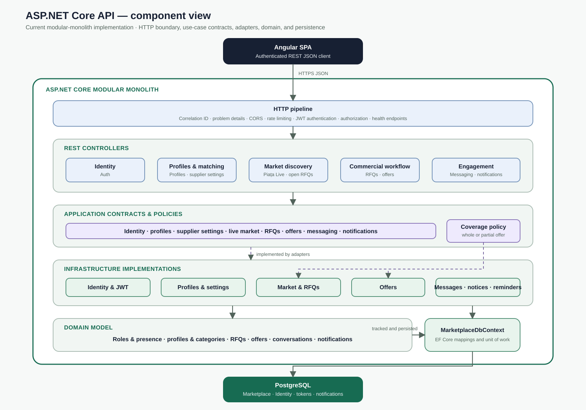

# C4 Level 3 — ASP.NET Core Backend Components

Status: Current implementation
Last updated: 2026-08-05

This view expands the **ASP.NET Core API** container from the C4 container diagram. It describes the implemented modular-monolith structure: controllers depend on application contracts, infrastructure services implement those contracts, and PostgreSQL is accessed through the shared EF Core context.



The visual above is the presentation view. The Mermaid diagram below remains the reviewable source-level dependency view.

```mermaid
flowchart TB
    spa["Angular SPA<br/>REST client"]
    postgres[("PostgreSQL<br/>Marketplace, Identity,<br/>refresh tokens and notifications")]

    subgraph Api["Marketplace.Api — HTTP composition root"]
        program["Program and dependency injection<br/>Configuration, OpenAPI and service wiring"]
        pipeline["HTTP pipeline<br/>Correlation ID, problem details, CORS,<br/>rate limiting, authentication and authorization"]
        health["Health endpoints<br/>Liveness and PostgreSQL readiness"]

        subgraph Controllers["REST controllers"]
            identityApi["Identity<br/>Auth"]
            profileApi["Profiles and matching<br/>Profiles, supplier settings"]
            marketApi["Market discovery<br/>Piața Live, open RFQs"]
            tradeApi["Commercial workflow<br/>RFQs and offers"]
            intakeApi["Assisted intake<br/>Extract, clarify and approve draft"]
            engagementApi["Engagement<br/>Messaging and notifications"]
        end
    end

    subgraph Application["Marketplace.Application — use-case contracts and policies"]
        identityPort["Identity contract"]
        profilePorts["Profile and supplier-setting contracts"]
        marketPorts["Live-market and RFQ contracts"]
        tradePort["Offer contract"]
        engagementPorts["Messaging and notification contracts"]
        coverage["Provider coverage policy<br/>Whole-request versus partial coverage"]
        intakePort["Assisted-intake contract"]
    end

    subgraph Infrastructure["Marketplace.Infrastructure — adapters and persistence"]
        identityService["Identity service<br/>ASP.NET Core Identity, JWT<br/>and refresh tokens"]
        profileServices["Profile and supplier-setting services"]
        marketServices["Live-market and RFQ services"]
        intakeService["Assisted-intake service<br/>OpenAI-compatible extraction<br/>and advanced-form fallback"]
        offerService["Offer service"]
        engagementServices["Messaging, notification and<br/>outcome-reminder services"]
        dbContext["MarketplaceDbContext<br/>EF Core unit of work and mappings"]
    end

    subgraph Domain["Marketplace.Domain — business state and invariants"]
        identityDomain["Identity roles and presence"]
        profileDomain["Buyer and Supplier profiles,<br/>categories and delivery settings"]
        rfqDomain["RFQ and RFQ items"]
        intakeDomain["Resumable intake session"]
        offerDomain["Offer and offer items"]
        engagementDomain["Conversation, messages<br/>and notifications"]
    end

    spa -->|"HTTPS JSON"| pipeline
    program --> pipeline
    program --> health
    program -.->|"registers implementations"| identityService
    program -.->|"registers implementations"| profileServices
    program -.->|"registers implementations"| marketServices
    program -.->|"registers implementations"| intakeService
    program -.->|"registers implementations"| offerService
    program -.->|"registers implementations"| engagementServices
    pipeline --> identityApi
    pipeline --> profileApi
    pipeline --> marketApi
    pipeline --> tradeApi
    pipeline --> intakeApi
    pipeline --> engagementApi

    identityApi --> identityPort
    profileApi --> profilePorts
    marketApi --> marketPorts
    tradeApi --> marketPorts
    tradeApi --> tradePort
    intakeApi --> intakePort
    engagementApi --> engagementPorts

    identityService -.->|"implements"| identityPort
    profileServices -.->|"implement"| profilePorts
    marketServices -.->|"implement"| marketPorts
    intakeService -.->|"implements"| intakePort
    offerService -.->|"implements"| tradePort
    engagementServices -.->|"implement"| engagementPorts

    marketServices --> coverage
    offerService --> coverage

    identityService --> identityDomain
    profileServices --> profileDomain
    marketServices --> identityDomain
    marketServices --> profileDomain
    marketServices --> rfqDomain
    intakeService --> rfqDomain
    intakeService --> intakeDomain
    offerService --> rfqDomain
    offerService --> offerDomain
    offerService --> engagementDomain
    engagementServices --> engagementDomain

    identityService --> dbContext
    profileServices --> dbContext
    marketServices --> dbContext
    intakeService --> dbContext
    offerService --> dbContext
    engagementServices --> dbContext
    health --> dbContext
    dbContext --> postgres
```



## Component responsibilities

| Component | Responsibility |
|---|---|
| Program and dependency injection | Compose the process, bind configuration, register implementations, seed roles, and expose controllers and health endpoints |
| HTTP pipeline | Correlation, centralized errors, CORS, authentication rate limiting, JWT authentication, and authorization |
| REST controllers | Translate HTTP requests and authenticated identity into application-contract calls and HTTP responses |
| Application contracts | Define the use cases available to the API without coupling controllers to EF Core implementations |
| Provider coverage policy | Share category-hierarchy compatibility and deterministically validate whether an offer covers an entire request or only part of it |
| Infrastructure services | Implement identity, profile, discovery, RFQ, offer, messaging, notification, and just-in-time outcome-reminder use cases |
| Domain model | Own entity state and invariants for profiles, matching configuration, RFQs, offers, conversations, and notifications |
| MarketplaceDbContext | Map domain/identity state, track transactions, and persist changes through Npgsql |
| Health endpoints | Distinguish process liveness from database-backed readiness |

## Dependency and transaction rules

- `Marketplace.Domain` does not depend on ASP.NET Core, EF Core, or infrastructure.
- `Marketplace.Application` contains contracts and deterministic policies; it depends inward on domain concepts.
- `Marketplace.Api` depends on application contracts and uses dependency injection rather than constructing infrastructure services.
- `Marketplace.Infrastructure` implements application contracts and is the only layer that owns EF Core, ASP.NET Core Identity, JWT creation, and PostgreSQL mappings.
- Infrastructure services use purpose-built EF Core queries directly; a generic repository is intentionally not introduced.
- Authorization is enforced at the HTTP boundary and resource ownership is revalidated in application implementations.
- State changes and their in-app notifications share the same `MarketplaceDbContext` transaction where the workflow requires atomicity.
- Outcome reminders are materialized on authenticated notification reads after a deadline, using the existing unique deduplication key rather than adding a scheduler for the MVP.

## Main source locations

```text
src/
  Marketplace.Api/
    Program.cs
    Middleware/
    Controllers/
    Health/
  Marketplace.Application/
    Identity/
    Profiles/
    Suppliers/
    Marketplace/
    Rfqs/
    Offers/
    Messaging/
    Notifications/
  Marketplace.Domain/
    Identity/
    Profiles/
    Suppliers/
    Marketplace/
    Rfqs/
    Offers/
    Messaging/
    Notifications/
  Marketplace.Infrastructure/
    Identity/
    Profiles/
    Suppliers/
    Marketplace/
    Rfqs/
    Offers/
    Messaging/
    Notifications/
    Persistence/
```
