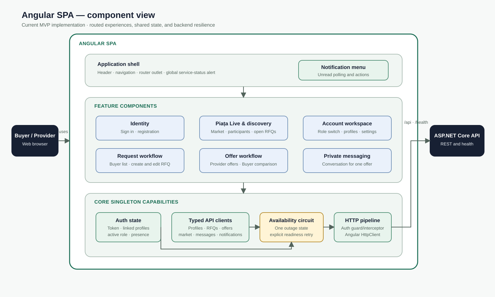
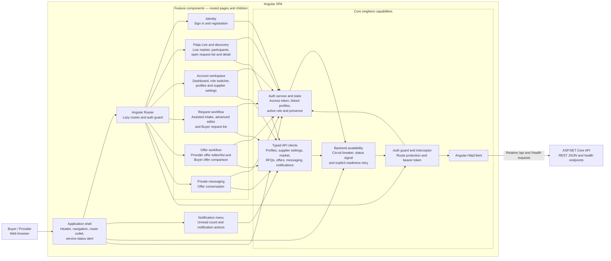

# C4 Level 3 — Angular Frontend Components

Status: Current implementation
Last updated: 2026-08-04

This view expands the **Angular SPA** container from the C4 container diagram. Components are grouped by responsibility rather than by individual source file so that the diagram remains useful as the UI evolves.



The visual above is the presentation view. The Mermaid diagram below remains the reviewable source-level dependency view.



## Component responsibilities

| Component | Responsibility |
|---|---|
| Application shell | Stable navigation, routed content, notification access, and the global backend-unavailable state |
| Angular Router | Lazy component loading, URL ownership, parameter extraction, and protected-route entry |
| Identity features | Registration and sign-in forms; delegate identity state to `AuthService` |
| Piața Live and discovery | Public market activity, dual-role presence, participant directory, matched open requests, and request detail |
| Account workspace | Buyer/Provider role switching, role-specific activity, profile editing, matching preferences, and request creation entry |
| Request workflow | Run clarification → research → editable proposal → human confirmation; transfer directly to the advanced editor when AI is unavailable; list/publish/cancel/extend/reopen Buyer requests |
| Offer workflow | Create/revise/submit/withdraw Provider offers with explicit coverage, tax, alternatives and delivery terms; compare every requested line and select a complete Buyer offer |
| Private messaging | Poll and send messages within the conversation authorized for one submitted offer |
| Notification menu | Poll unread count, load notifications, mark items read, and follow notification links |
| Auth service and state | Access token, linked profiles, active role, refresh, logout, and online-presence heartbeat |
| Typed API clients | Feature-focused HTTP contracts; keep transport calls out of presentation components |
| Auth guard and interceptor | Require authentication for protected routes and attach the bearer token |
| Backend availability | Open the client-side circuit after an unavailable API response, suppress repeated calls, expose one status, and retry readiness explicitly |

## Dependency rules

- Routed feature components may depend on `core` capabilities and shared presentation data, but core services must not depend on feature components.
- Components do not call backend URLs directly; transport belongs in typed core services.
- The active profile controls role-specific presentation, while linked profiles determine which valid Buyer and Provider capabilities remain available.
- Authentication and backend availability are cross-cutting concerns applied once in the HTTP pipeline.
- The API remains the authority for authentication, authorization, validation, matching, offer state, and data privacy.
- Signals hold local and derived UI state; RxJS represents HTTP and polling streams, consistent with ADR-0009.

## Main source locations

```text
src/marketplace-web/src/app/
  app.*                         Application shell
  app.routes.ts                 Route map
  core/auth/                    Identity state, guard, interceptor
  core/connectivity/            Backend availability circuit
  core/*                        Typed API clients
  features/landing/             Piața Live and participant discovery
  features/dashboard/           Account workspace
  features/profiles/            Profile and matching settings
  features/rfqs/                Request workflows
  features/offers/              Offer workflows
  features/messaging/           Private conversations
  features/notifications/       Notification menu
```
