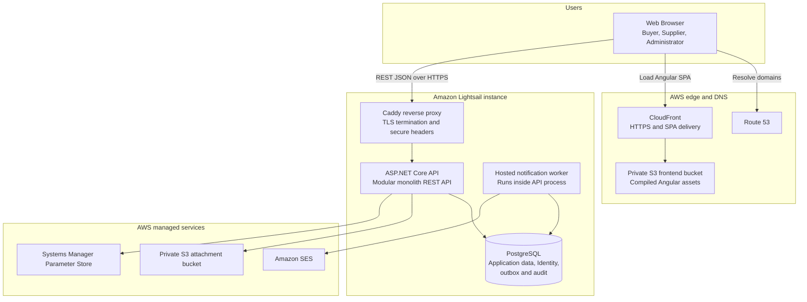

# C4 Level 2 — Container Diagram

Status: Proposed

## Container responsibilities

| Container | Responsibility |
|---|---|
| Angular SPA | Responsive UI, reactive forms, client routing, presentation state |
| Caddy | Public ports 80/443, automatic TLS, reverse proxy, headers |
| ASP.NET Core API | Authentication, authorization, use cases, domain rules, REST endpoints |
| Hosted worker | Claims notification rows, renders templates, sends email, retries safely |
| PostgreSQL | Transactional source of truth, Identity, outbox, audit |
| Frontend S3 + CloudFront | Private static origin and global HTTPS SPA delivery |
| Attachment S3 | Private binary object storage |
| SES | Transactional email transport |
| Parameter Store | Runtime secret/configuration source |

## Modular monolith boundary

The API contains the modules Identity, Buyers, Suppliers, Categories, RequestsForQuotation, Offers, Messaging, Attachments, Notifications, and Administration. These are code and ownership boundaries, not separately deployed processes.

The notification worker is shown separately to expose its responsibility, but it is hosted in the same API process for the MVP.
