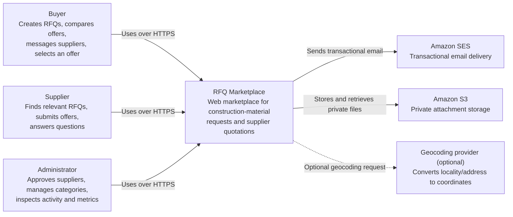

# C4 Level 1 — System Context

Status: Proposed

## System responsibilities

The RFQ Marketplace owns:

- account registration, verification, authentication, and authorization;
- buyer and supplier profiles;
- supplier approval and service-area configuration;
- RFQ drafting, publication, and expiry;
- deterministic supplier relevance;
- offer entry, revision, comparison, and acceptance;
- private buyer–supplier conversations;
- attachment authorization and metadata;
- durable notifications and audit history;
- administrative inspection and MVP metrics.

## Trust boundaries

- Browser input is untrusted and every command is revalidated by the API.
- Supplier-visible RFQ projections omit unnecessary buyer-sensitive data.
- Offer and conversation access is resource-authorized, not merely role-authorized.
- AWS services are external systems accessed with least-privilege credentials.
- The optional geocoder receives only the minimum location data needed.

## Out of scope

Payments, contracts, invoicing, inventory, delivery tracking, public competing prices, machine learning, native mobile apps, microservices, and real-time bidding are outside the MVP boundary.
