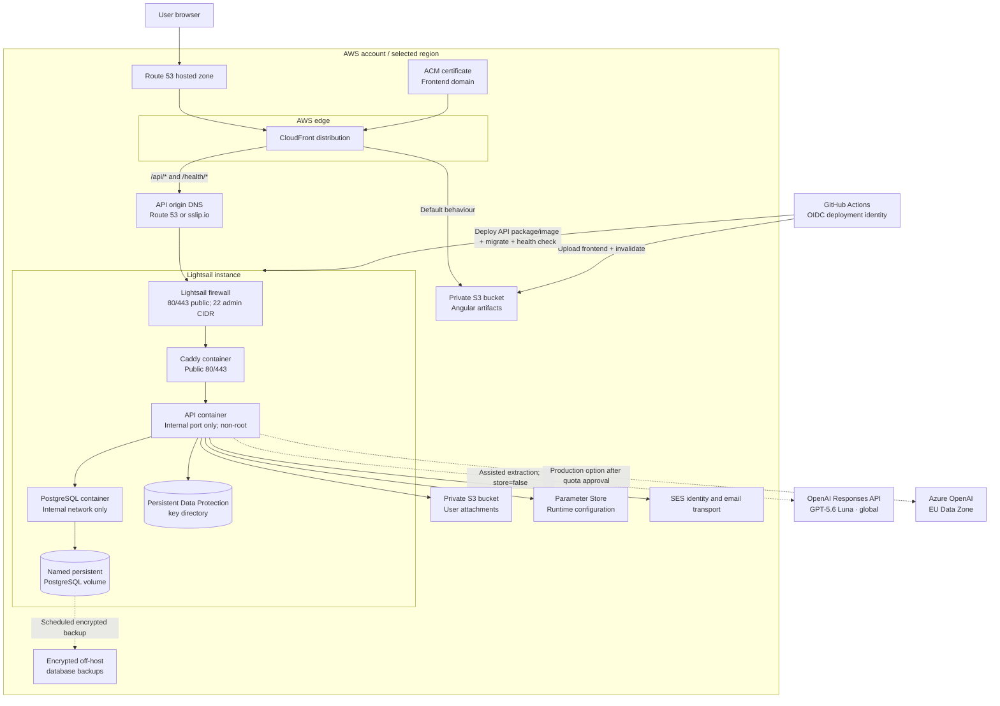

# Deployment Diagram

Status: Implemented and verified in AWS production (legacy “staging” resource names)

## Deployment properties

- With a custom domain, `app.example.com` resolves to CloudFront. A future domainless Staging uses the generated CloudFront hostname.
- Angular uses relative `/api/*` URLs. CloudFront's default behaviour serves S3, while ordered `/api/*` and `/health/*` behaviours use Caddy as the API origin.
- An origin-only DNS name resolves to the Lightsail static IP. A future domainless Staging uses `<static-ip>.sslip.io` so Caddy can obtain origin TLS without buying a domain.
- The API and PostgreSQL ports are not exposed publicly.
- Caddy manages origin TLS; CloudFront uses ACM for the public frontend TLS.
- PostgreSQL data survives container restarts through a named volume.
- ASP.NET Core Data Protection keys survive API replacement in a host directory restricted to the container user. The MVP stores those keys on the encrypted host disk rather than adding a separate KMS integration.
- Backups must be stored off-instance and restoration must be tested before production.
- Terraform provisions infrastructure. Deployment automation delivers application artifacts and runs migrations.
- Production deployment requires a protected environment/manual approval.
- GitHub Actions receives temporary AWS credentials through OIDC; there are no long-lived AWS keys in GitHub.
- Assisted extraction reuses the existing API container and database. `ai-intake-api-key` is stored as an encrypted Parameter Store value; provider, endpoint and model are ordinary runtime parameters. When AI configuration or provider execution is unavailable, request creation transfers to the advanced form.
- Direct OpenAI is the development/staging default and uses the global Responses endpoint. Azure OpenAI is a configuration-only alternative intended for production after EU Data Zone quota approval. Requests use `store=false`, and the application persists the authoritative transcript and draft in PostgreSQL.
- AI infrastructure is usage-based rather than always-on. GPT-5.6 Luna standard pricing is `$1.00` per million input tokens and `$6.00` per million output tokens; EU data-residency/Data Zone processing is approximately 10% higher. There is no web-search or gateway charge. Recheck prices and regional availability before production approval.

## Availability constraint

API and database share one low-cost instance. Instance or disk failure can interrupt the entire transactional system. This is an explicitly accepted MVP constraint, mitigated by health checks, monitoring, backups, and a documented restore procedure—not by premature high-availability infrastructure.
