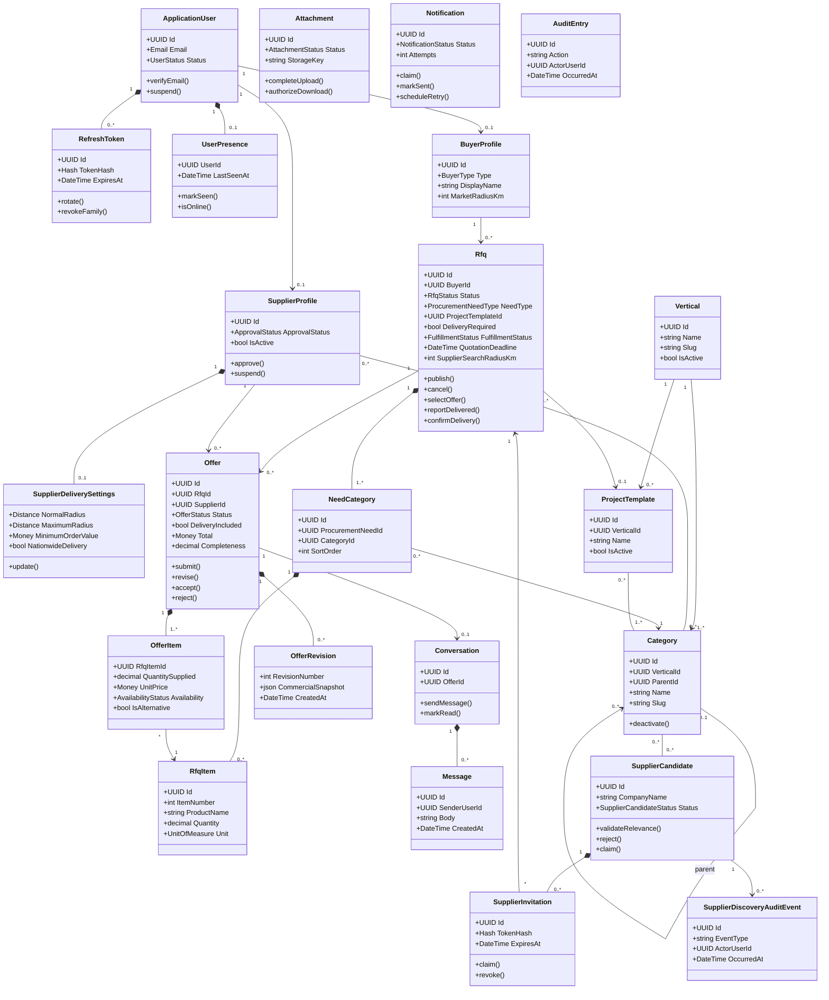

# Domain Model and Aggregate Boundaries

Status: Implemented through the central category, procurement need, offer, conversation, and supplier-discovery aggregates; attachments remain proposed

## Aggregate ownership

| Aggregate root | Owned state | Important invariants |
|---|---|---|
| `ApplicationUser` | Refresh-token families | Email uniqueness; token rotation and revocation |
| `UserPresence` | Last activity heartbeat | One record per user; online status expires after two minutes |
| `BuyerProfile` | Buyer profile fields and market radius | One profile per user; radius is 1–1,000 km and defaults to 30 km |
| `SupplierProfile` | Categories, delivery areas, preferences | Approved and active to participate; valid radii |
| `Vertical` | Market boundary and active state | Construction is the only active MVP vertical |
| `Category` | Central category identity, vertical, and optional parent link | One taxonomy is reused by needs, Providers, templates, and discovery; unique slug; no parent cycle |
| `Rfq` / `ProcurementNeed` | Need type, exactly one primary `NeedCategory`, optional requirement lines, optional project template, and supplier-search radius | Need type never controls category; requirement lines have no category association; publication requires a future deadline; published needs are immutable |
| `ProjectTemplate` | Editable starting set of central categories for a project | A template is not a category and references at least one category in its vertical |
| `Offer` | Offer items and revision snapshots | One per supplier/RFQ; server-calculated money and completeness |
| `Conversation` | Messages and participant read state | Exactly the RFQ buyer and offer supplier may participate |
| `Attachment` | File metadata and lifecycle | Authorized parent; verified object before availability |
| `Notification` | Attempts and delivery state | At-least-once, safely retryable delivery |
| `SupplierCandidate` | Sourced company data, central-category coverage, human review, claim link | Covers one or more central categories; starts unverified; only reviewed candidates may be invited; one claim |
| `SupplierInvitation` | One candidate/request invitation and hashed token | Future expiry; opaque token; one active claim; concurrency protected |

`AuditEntry` and `SupplierDiscoveryAuditEvent` are append-only operational evidence rather than behavior-rich aggregates.

## Cross-aggregate consistency

Offer acceptance modifies one RFQ and multiple offers. It is an application use case executed in one PostgreSQL transaction with concurrency protection. The transaction:

1. verifies buyer ownership and RFQ openness;
2. verifies selected offer status and validity;
3. accepts exactly one offer;
4. rejects competing submitted/revised offers;
5. moves the RFQ to `OfferSelected`;
6. appends audit and notification records.

## Commercial calculations

- Money uses `decimal`/`numeric`, never floating point.
- `line total = quantity supplied × unit price`.
- Offer subtotal is the sum of line totals.
- Total follows a documented rounding order using subtotal, transport, discount, and VAT.
- Completeness is quantity-weighted per requested line and capped at requested quantity.
- Unit conversions are not inferred. A different unit must be represented as an alternative and receives no automatic equivalence.
- Backend results are authoritative; frontend calculations are previews only.
