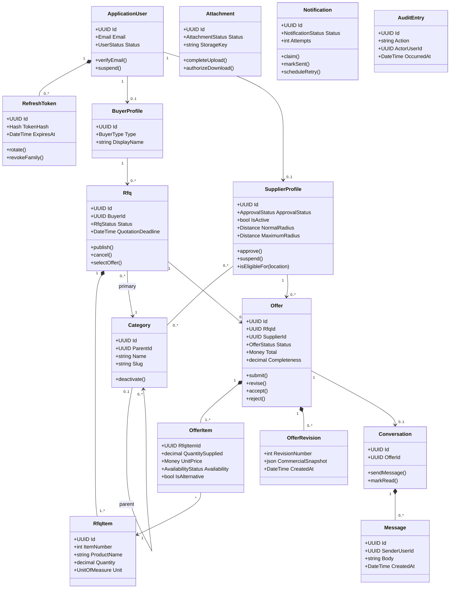

# Domain Model and Aggregate Boundaries

Status: Proposed

## Aggregate ownership

| Aggregate root | Owned state | Important invariants |
|---|---|---|
| `ApplicationUser` | Refresh-token families | Email uniqueness; token rotation and revocation |
| `BuyerProfile` | Buyer profile fields | One profile per user; user owns profile |
| `SupplierProfile` | Categories, delivery areas, preferences | Approved and active to participate; valid radii |
| `Category` | Category identity and parent link | Unique slug; no parent cycle |
| `Rfq` | RFQ items and category links | At least one item; valid deadline; controlled state transitions |
| `Offer` | Offer items and revision snapshots | One per supplier/RFQ; server-calculated money and completeness |
| `Conversation` | Messages and participant read state | Exactly the RFQ buyer and offer supplier may participate |
| `Attachment` | File metadata and lifecycle | Authorized parent; verified object before availability |
| `Notification` | Attempts and delivery state | At-least-once, safely retryable delivery |

`AuditEntry` is append-only operational evidence rather than a behavior-rich aggregate.

## Cross-aggregate consistency

Offer acceptance modifies one RFQ and multiple offers. It is an application use case executed in one PostgreSQL transaction with concurrency protection. The transaction:

1. verifies buyer ownership and RFQ openness;
2. verifies selected offer status and validity;
3. accepts exactly one offer;
4. rejects competing submitted/revised offers;
5. moves the RFQ to `OfferSelected`;
6. appends audit and notification records.

## Commercial calculations

- Money uses `decimal`/`numeric`, never floating point.
- `line total = quantity supplied × unit price`.
- Offer subtotal is the sum of line totals.
- Total follows a documented rounding order using subtotal, transport, discount, and VAT.
- Completeness is quantity-weighted per requested line and capped at requested quantity.
- Unit conversions are not inferred. A different unit must be represented as an alternative and receives no automatic equivalence.
- Backend results are authoritative; frontend calculations are previews only.
