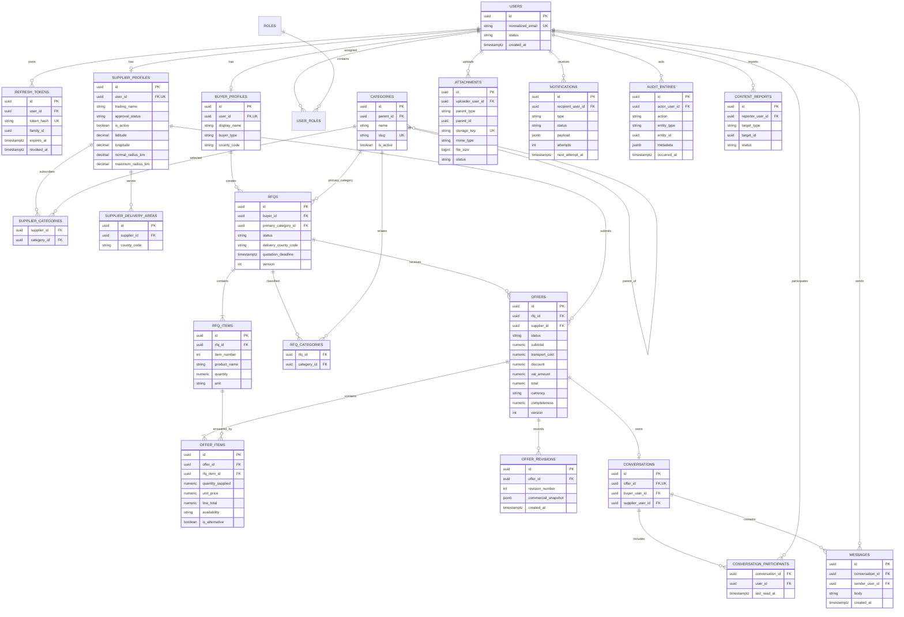

# Entity–Relationship Diagram

Status: Proposed

## Required constraints and indexes

- Unique `(supplier_id, category_id)`, `(supplier_id, county_code)`, `(rfq_id, category_id)`.
- Unique `(rfq_id, item_number)`, `(rfq_id, supplier_id)`, `(offer_id, rfq_item_id)`.
- Unique `(offer_id, revision_number)` and one conversation per offer.
- Positive RFQ quantities; non-negative prices, transport, VAT, and discounts.
- Latitude in `[-90, 90]`; longitude in `[-180, 180]`.
- Completeness in `[0, 100]`; delivery radii are non-negative and maximum is not below normal.
- Money columns use `numeric(19,4)`. Display rounding is currency-specific and occurs at defined calculation boundaries.
- Index RFQ discovery on status, deadline, category, and county.
- Index offer comparison on `(rfq_id, status)`.
- Index notification claiming on `(status, next_attempt_at)`.
- Index messages on `(conversation_id, created_at, id)`.
- Index audit records on `(entity_type, entity_id, occurred_at)`.

Attachments use a pragmatic polymorphic parent reference. The API centralizes parent authorization, and integration tests cover it because the database cannot provide a conventional foreign key to multiple parent tables.
