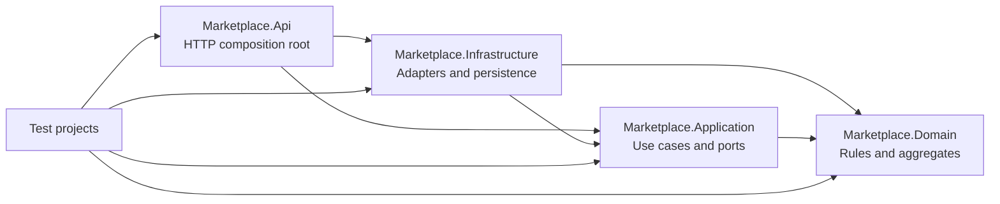

# Proposed Repository and Folder Structure

Status: Proposed

```text
MVP business/
  Marketplace.sln
  Directory.Build.props
  Directory.Packages.props
  global.json
  .editorconfig
  .gitignore
  .env.example
  README.md

  src/
    Marketplace.Api/
      Authentication/
      Authorization/
      Middleware/
      OpenApi/
      Health/
      Configuration/

    Marketplace.Application/
      Abstractions/
      Identity/
      Buyers/
      Suppliers/
      Categories/
      Rfqs/
      Offers/
      Messaging/
      Attachments/
      Notifications/
      Administration/

    Marketplace.Domain/
      Common/
      Identity/
      Buyers/
      Suppliers/
      Categories/
      Rfqs/
      Offers/
      Messaging/
      Attachments/
      Notifications/
      Administration/

    Marketplace.Infrastructure/
      Persistence/
        Configurations/
        Migrations/
        Seeding/
      Identity/
      Email/
      Storage/
      Geocoding/
      BackgroundJobs/
      Observability/

    marketplace-web/
      src/app/
        core/
        shared/
        features/
          public/
          identity/
          buyer/
          supplier/
          administration/

  tests/
    Marketplace.Domain.Tests/
    Marketplace.Application.Tests/
    Marketplace.IntegrationTests/
    marketplace-web/

  deploy/
    compose/
    caddy/
    scripts/

  infrastructure/
    bootstrap/
    modules/
      lightsail-host/
      frontend/
      attachments/
      dns/
      email/
      identity-federation/
    environments/
      dev/
      prod/

  docs/
    architecture/
    decisions/
    deployment/

  .github/workflows/
```

## Dependency direction



The Domain project has no dependency on EF Core, ASP.NET Core, AWS SDKs, or Angular. The API is the composition root.

## Backend module rules

- A module owns its domain types, use cases, request/response models, and persistence mappings.
- Modules may query another module through explicit application interfaces or purpose-built projections.
- Cross-module state changes go through named use cases, not direct controller manipulation.
- EF Core is used through a concrete application persistence boundary; no generic repository.
- Shared code is limited to proven cross-cutting concepts such as IDs, money, time, pagination, and Problem Details.

## Angular feature rules

- Standalone, lazy-loaded route components.
- Reactive Forms and Angular Material.
- Signals for feature-local state; RxJS for asynchronous streams.
- No NgRx until concrete complexity demonstrates a need.
- `core` contains singleton technical capabilities; `shared` contains reusable presentation primitives; business screens remain under `features`.

## Infrastructure rules

- Terraform environments compose small modules without duplicating resource internals.
- Terraform provisions infrastructure but does not perform routine application deployment.
- Docker Compose contains `reverse-proxy`, `api`, and `postgres`.
- Production secrets are external configuration and are never committed.
