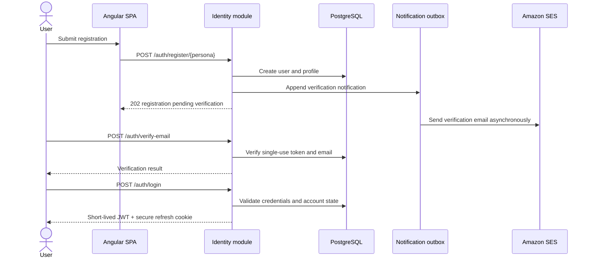
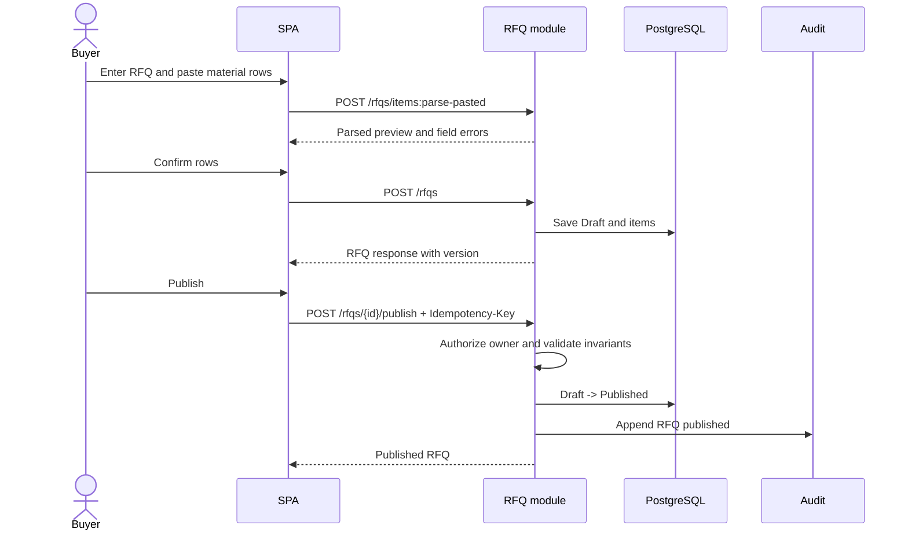
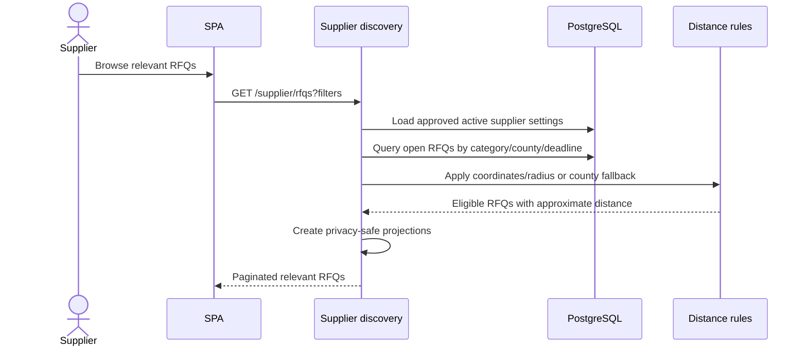
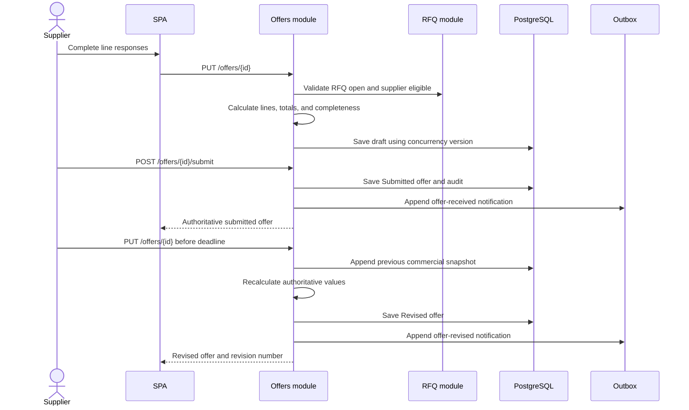
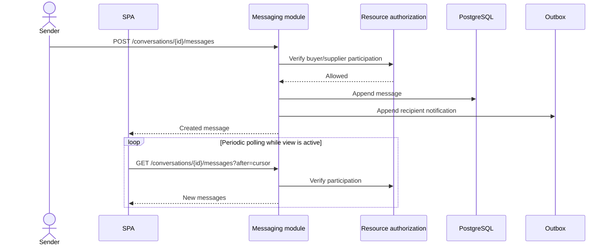
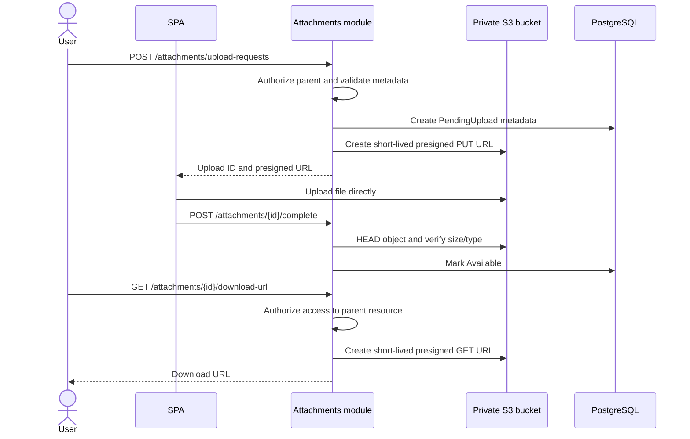
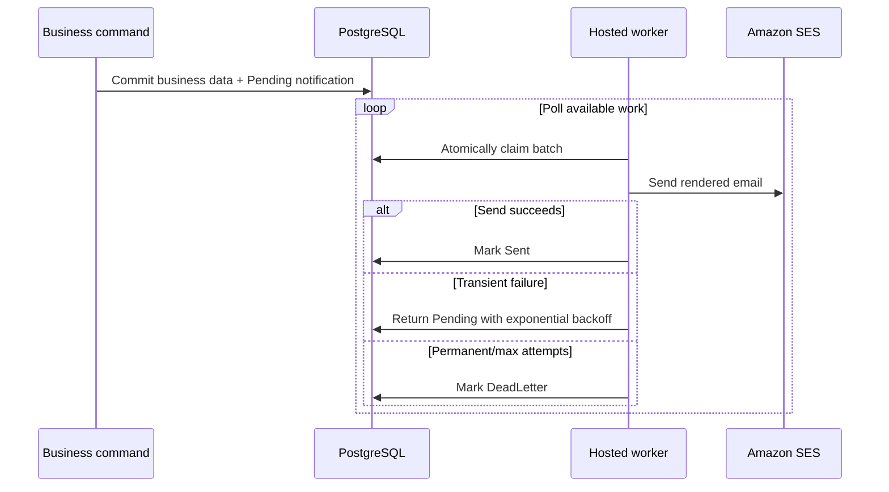

# Main Sequence Diagrams

Status: Proposed

## Registration, verification, and login



## RFQ creation and publication



## Supplier discovery



## Offer submission and revision



## Private messaging



## Transactional offer acceptance

```mermaid
sequenceDiagram
    actor Buyer
    participant SPA
    participant API as Offer acceptance use case
    participant DB as PostgreSQL
    participant Outbox

    Buyer->>API: POST /rfqs/{rfqId}/offers/{offerId}/accept
    Note over Buyer,API: Idempotency-Key and expected RFQ version
    API->>DB: Begin transaction
    API->>DB: Load and protect RFQ + candidate offer
    API->>API: Authorize owner; verify open RFQ, deadline, validity
    API->>DB: Mark candidate Accepted
    API->>DB: Mark competitors Rejected
    API->>DB: Mark RFQ OfferSelected
    API->>DB: Append audit and notification rows
    API->>DB: Commit
    API-->>SPA: Accepted offer and updated RFQ
    Outbox-->>Buyer: Send confirmation asynchronously
    Outbox-->>Outbox: Notify winning and unsuccessful suppliers
```

The database transaction and concurrency controls guarantee one winner even when acceptance requests race.

## Attachment upload and download



## Notification processing


