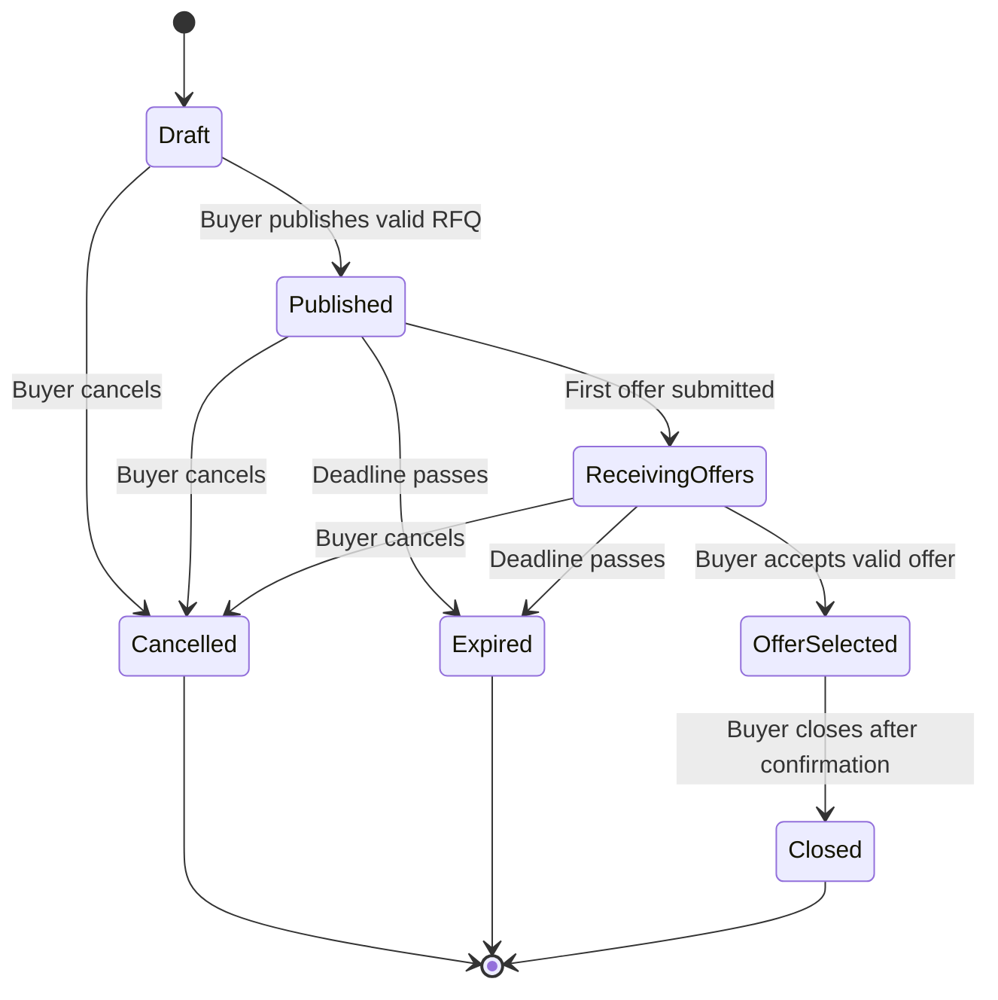
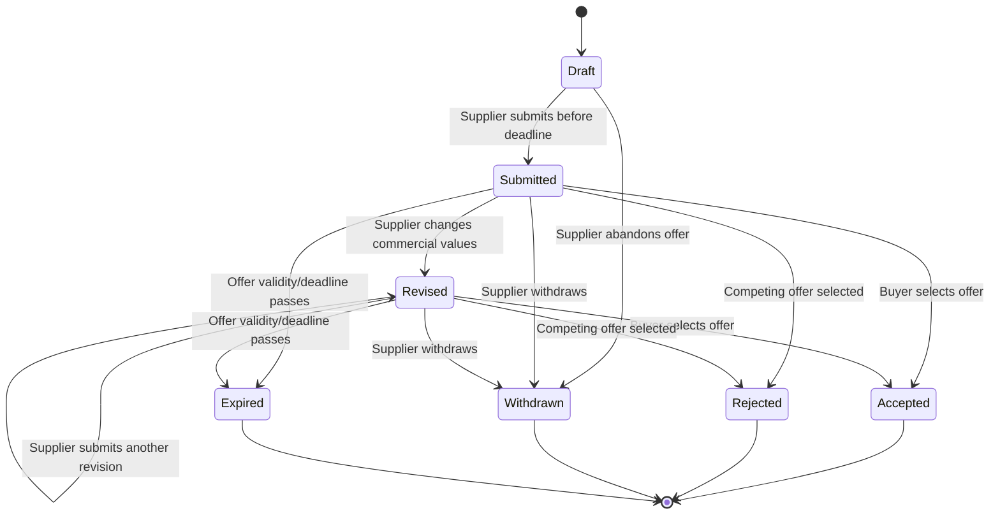
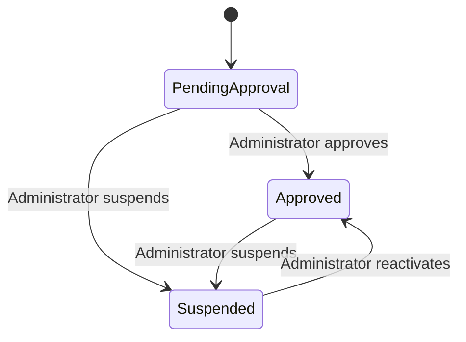
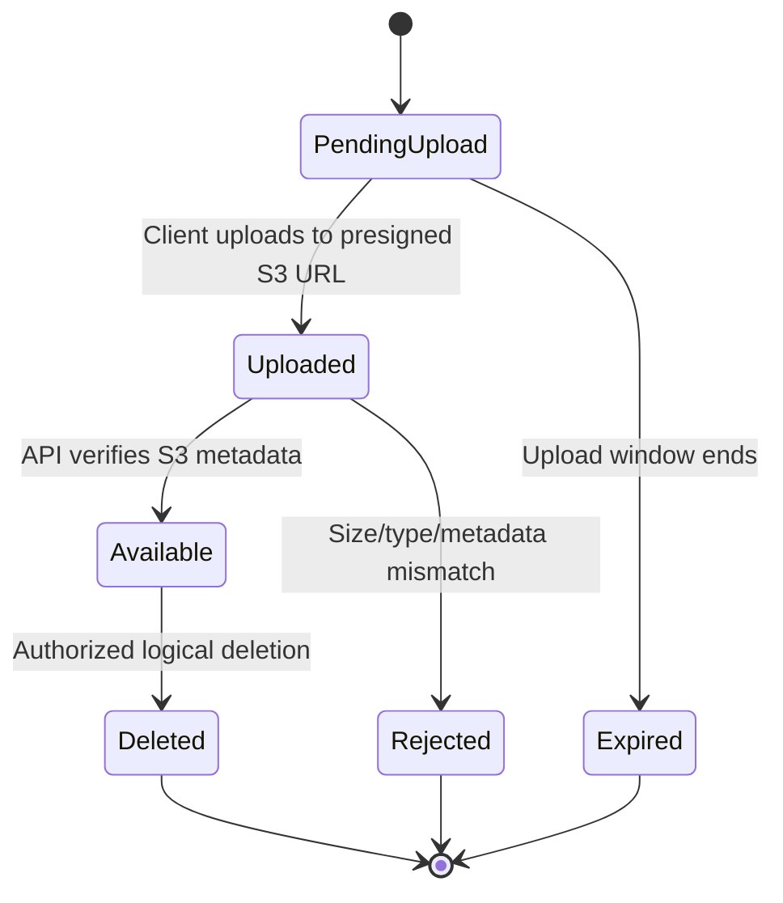
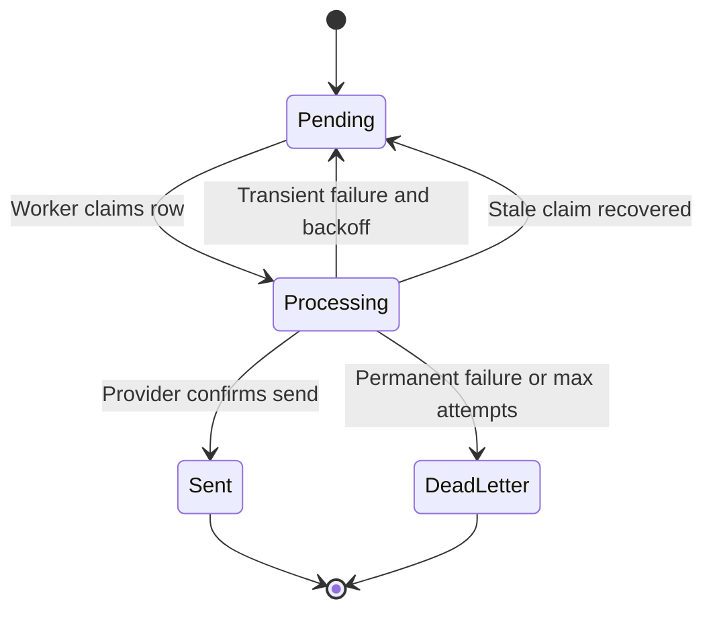

# State Diagrams

Status: Proposed

## RFQ lifecycle

Commercial fields are editable in `Draft`. After publication, changes are audited; after the first offer, quantity and specification changes are blocked in the MVP.

## Offer lifecycle

Revisions append immutable commercial snapshots. No transition out of a terminal state is allowed.

## Supplier lifecycle

An additional `is_active` setting lets an approved supplier voluntarily pause participation without changing administrative approval.

## Attachment lifecycle

Only `Available` attachments receive download URLs.

## Notification lifecycle

Delivery is at-least-once. A deduplication key prevents repeated business events from creating duplicate notification intent.
