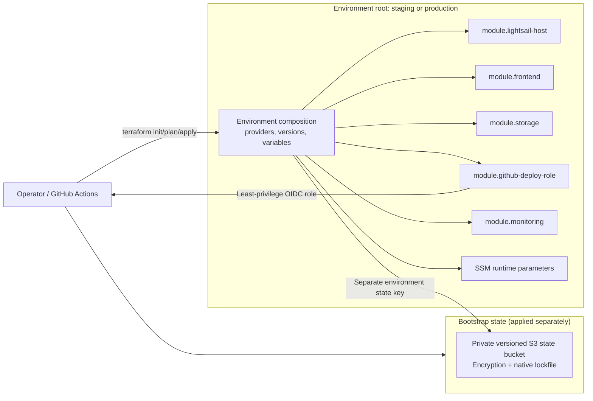

# Terraform Infrastructure Diagram

Status: Implemented and drift-free in AWS staging

## Terraform/application boundary

Terraform owns:

- Lightsail instance, static IP, firewall, and minimal cloud-init;
- private frontend and attachment buckets;
- CloudFront, origin access control, cache/error behavior, and headers;
- Route 53 records and certificate validation;
- SES identity and DNS verification records;
- CI OIDC provider and least-privilege roles;
- remote state controls.

Terraform does not:

- build application code;
- embed application secrets in user data;
- use routine `remote-exec`;
- permanently deploy the API;
- run normal database migrations;
- upload each frontend release.

## Environment isolation

- `staging` and `production` are separate Terraform roots and state keys.
- Environment-specific values are passed through non-secret reviewed variables.
- Secret `.tfvars`, state, plans, and `.terraform/` are excluded from Git.
- Provider and Terraform versions are constrained.
- State uses S3 versioning, encryption, and `use_lockfile = true`.
